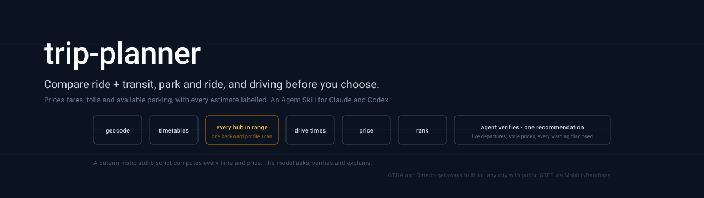

<p align="center">
  
</p>

<h1 align="center">trip-planner</h1>

<p align="center">
  <strong>Compare ride + transit, park and ride, and driving before choosing your trip.<br/>
  Prices fares, tolls and available parking, with explicit estimates and data limitations.</strong>
</p>

<p align="center">
  <a href="https://opensource.org/licenses/MIT"></a>
  <a href="https://github.com/RZ-Logic/trip-planner-skill/actions/workflows/tests.yml"></a>
  <a href="https://www.python.org/"></a>
  <a href="https://agentskills.io"></a>
  
  
  
</p>

<p align="center">
  <a href="#-quick-start">Quick Start</a> •
  <a href="#-example">Example</a> •
  <a href="#-what-it-does">What It Does</a> •
  <a href="#-does-it-work">Does It Work?</a> •
  <a href="#-optional-api-keys">API Keys</a> •
  <a href="#-limitations">Limitations</a> •
  <a href="#-documentation">Docs</a> •
  <a href="#%EF%B8%8F-roadmap">Roadmap</a> •
  <a href="#-why-i-built-this">Why</a>
</p>

---

trip-planner is an [Agent Skill](https://agentskills.io): a folder of instructions and standard-library Python that Claude, Codex and other coding agents run when you ask how to get somewhere. Ask "cheapest way from Milton to Mississauga at 9 pm?" or "is the 407 worth it to Markham at 7:30, and where do I park?". The agent runs the planner, checks what the data cannot vouch for, and answers with one recommendation and a short comparison.

**Why not just a map app?** Map apps rarely combine a ride with transit, and when they do, they show a sample, not every option. On 2026-10-12 we asked the phone apps for Milton Community Park to Square One on a weekday at 21:00. Google Maps' "mixed modes" offered two plans with a Lyft ride to a Hwy 407 park and ride, but the price it showed ($8.75 for one) was only the GO single-ticket fare: it left out the Lyft ride, and a PRESTO card pays $7.38 for that bus. This skill prices that plan at about $25 with the ride, and its top pick was one Google did not show: a ride to Winston Churchill at Eglinton for the MiWay 109 express, arriving 21:51, 14 minutes before the park-and-ride option. The Transit app and Citymapper offered no ride-plus-transit plan, and on 2026-10-11 neither did the web planners of Google Maps, Citymapper and Moovit. The details are in [`references/sources.md`](plugins/trip-planner/skills/trip-planner/references/sources.md#7-map-apps-what-they-can-and-cannot-do).

---

## 🚀 Quick Start

### Requirements

- **Python 3.8 or later.** The scripts use the standard library only, so there is nothing to `pip install`.
- **Network access** for live data: timetables, routing, geocoding, parking, fuel, weather and chargers (the hosts are listed in [`references/driving.md`](plugins/trip-planner/skills/trip-planner/references/driving.md); `--check-network` tests them). Without it, the agent uses the bundled data and the manual method.
- **Optional: API keys** for live traffic, highway incidents, more charger lookups and review rates (see [Optional API Keys](#-optional-api-keys)).
- **Optional: a tool that can open any URL** (an HTTP or fetch connector such as Scrapling's MCP server, or a browser tool), so the agent can check parking prices and run the manual method. The scripts never use it.

### Install

The skill is the folder [`plugins/trip-planner/skills/trip-planner/`](plugins/trip-planner/skills/trip-planner/). The copy and zip rows need the repo first: `git clone https://github.com/RZ-Logic/trip-planner-skill`.

| Where | How |
|---|---|
| Claude Code plugin | `/plugin marketplace add RZ-Logic/trip-planner-skill`, then `/plugin install trip-planner@rz-logic-skills` |
| Codex plugin | `codex plugin marketplace add RZ-Logic/trip-planner-skill`, then install from the Plugins Directory |
| Any client | `npx skills add RZ-Logic/trip-planner-skill` |
| Claude Code (copy) | `cp -r plugins/trip-planner/skills/trip-planner ~/.claude/skills/` |
| Codex, Gemini CLI, Cursor, Copilot (copy) | `cp -r plugins/trip-planner/skills/trip-planner ~/.agents/skills/` |
| claude.ai | `python tools/build_zip.py`, then Customize > Skills > + > Upload `dist/trip-planner.zip`. Turn on code execution and network access. |
| Claude API | Upload the zip with `POST /v1/skills` and attach it to a container with the code execution tool. The API sandbox has no network, so the agent uses the bundled data and the manual method. With `lat,lon` and `--routing estimate`, a trip whose timetables are all hand-entered or cached still plans offline, with an `OFFLINE` WARNING. |

### Try it

Ask your agent in plain words:

- "Cheapest way from Milton Community Park to Square One at 9 pm tonight, mixing Uber and transit?"
- "I'm driving to Niagara Falls now in a 2023 RAV4 Hybrid. Is the 407 worth it, and where's cheap parking for 4 hours?"
- "Get me to Union Station by 9:00 tomorrow. Should I drive or park at a GO station?"

Or run the scripts directly (Python 3.8+, no installs):

```bash
cd plugins/trip-planner/skills/trip-planner
python scripts/trip_hubs.py --origin "43.4988,-79.8560" --dest "43.5933,-79.6441" --depart "2026-10-15 21:00"
python scripts/drive_plan.py --origin "43.4988,-79.8560" --dest "43.0791,-79.0784" --depart now --stay-hours 4 --car "2023 Toyota RAV4 Hybrid"
```

---

## 🧪 Example

**Ride + transit.** Milton Community Park to Square One, Mississauga, leaving at 21:00 on a weekday (trimmed):

```text
$ python scripts/trip_hubs.py --origin "43.498757,-79.855987" --dest "43.5933,-79.6441" --depart "2026-10-15 21:00"
COVERAGE  1495 stops in range grouped into 635 hubs, 610 of them reach the destination in the window.
BASELINE ride all the way: arrive 21:35, 29.5 km, 29 min, ~40 CAD (osrm x1.00)
BASELINE transit only: leave by 21:25, arrive 23:13, transit fare 7.75 CAD (Milton Transit 4.25; Brampton Transit free from Milton Transit (Milton route 21 paper transfer); MiWay 3.50)

BEST TRADE-OFFS (no other hub is both cheaper, fare included, and earlier)
 1. Winston Churchill Blvd At Eglinton Ave  [MiWay]
    ride 19.1 km / 24 min (osrm x1.00), ~28 CAD  |  book by 21:00, board 21:34, ARRIVE 21:51
    transit fare 3.50 CAD (MiWay 3.50), total ~32 CAD
        MiWay 109 "109 S Express Meadowvale Exp": Winston Churchill Blvd At Eglinton Ave -> City Centre Transit Terminal Platform A (21:34-21:47, 3 stops)
    backup if missed: MiWay 109 "109 S Express Meadowvale Exp" at 21:49, arrive 22:06
 2. Bronte Rd. @ Hwy. 407 Park & Ride  [GO Transit]
    ride 10.3 km / 13 min (osrm x1.00), ~18 CAD  |  book by 21:08, board 21:31, ARRIVE 22:05
    transit fare 7.38 CAD (GO Transit 7.38), total ~25 CAD
        GO Transit 47 "47G - Erin Mills": Bronte Rd. @ Hwy. 407 Park & Ride -> Trafalgar Rd. @ Hwy. 407 Park & Ride (21:31-21:39, nonstop)
        GO Transit 40 "40C - Unionville GO": Trafalgar Rd. @ Hwy. 407 Park & Ride -> Square One (21:45-22:00, nonstop)
    backup if missed: GO Transit 41 "41 - Pickering GO" at 21:46, arrive 22:20
```

Riding all the way arrives first (21:35, about $40). A ride to Winston Churchill at Eglinton for the MiWay 109 arrives at 21:51 for about $32, the 407 park and ride at 22:05 for about $25, and transit alone at 23:13 for $7.75. The agent picks by the user's priority and gives the hub name to type into Uber, the bus to board and the backup.

**Driving.** Milton Community Park to Bay St, Toronto, arriving by 09:00 on a weekday, parked all day (trimmed):

```text
$ python scripts/drive_plan.py --origin "43.498757,-79.855987" --dest "43.6453,-79.3806" --arrive-by "2026-10-14 09:00" --stay-hours 9 --car "2022 Toyota Corolla"
CAR        2022 Toyota Corolla: 7.9 city / 6.2 hwy L/100 km, regular (NRCan 2022 rating, median of 9 variants)
ROUTES
  A. Fastest via 407 ETR (Bronte Rd to Hwy 403, 11 km): 60 km, about 1 h 10 (allow 1 h 40), leave by 07:06, arrive 08:16
     407 ETR eastbound, weekday 07:00 to 09:30 band: $7.75 with a transponder, $13.05 without (+$5 account fee that month)
     fuel ~$7.40 (60 km at 6.6 L/100 km, $1.876/L Toronto West regular, week of 2026-10-05)
  B. Toll-free via Derry Road West, Hwy 401, Hwy 427, Gardiner Expressway: 56 km, about 1 h 10 (allow 1 h 42), leave by 07:03, arrive 08:13, fuel ~$6.93, total ~$6.93
TRADE-OFF  The 407 lets you leave 3 min later (typical drive about the same) for $18.52 ($370/h). At $30/h of your time: take B (toll-free).
ARRIVAL    Leave by 07:03 to be at the door by 09:00 (planned on the allow time 1 h 42 + parking 4 + walk 5 + 5 min spare).
PARKING    near the destination, 9 h stay, parked 08:13 to 18:05 (9 h 52), within 800 m
  1. Public garage S of the destination: $18.00 for 9 h 52, 335 m walk (osm, OpenStreetMap); price given for Mon-Fri only
  2. Impark: $22.00 for 9 h 52, 282 m walk (stale, OpenStreetMap); price given for Mon-Fri only; price tagged as of 2019
  3. Green P 40 York Street: $25.00 for 9 h 52 (2019 data), 225 m walk (stale, Green P 2019 open data); 2019 rates; check the Green P page
PARK AND RIDE  run because the destination is in downtown Toronto
  1. Drive 4.4 km to Milton GO (free GO parking, first come, first served; busy lots can fill on weekday mornings), leave by 07:17, board GO Transit MI "Milton GO 07:45 - Union Station GO 08:48" at 07:45, arrive 08:48
     there and back: car $1.08 + fares $20.66 = $21.74, vs driving ~$13.87 + parking $18.00 = $31.87; leave 14 min later than driving
```

The trade-off prices the default case, no transponder: the $13.05 toll, the $5 account fee and $0.47 more fuel make $18.52. With `--transponder` it is $8.22 (about $164 an hour); the pick is the same. The agent would propose Milton GO, about $21.74 there and back against $31.87 to drive and park, once it has found a train back at the user's return time and checked the lots marked `osm` or `stale`.

---

## ⚡ What It Does

**Ride + transit** ([`trip_hubs.py`](plugins/trip-planner/skills/trip-planner/scripts/trip_hubs.py))
- Checks every transit stop within ride range in one backward pass over the GTFS timetables. A Milton trip compares 1,384 stops in 594 hubs in under a second.
- Prices each option: the ride from regional Uber rate cards, then fares with free and credited transfers.
- Gives the latest time to book, a backup departure and check links.
- Plans forward or to a deadline. Getaways use intercity rail and coach, hand-entered rural timetables and a taxi at either end where ride-hail is sparse or absent.
- Works beyond Ontario through MobilityDatabase feed discovery. Optional second opinion from the Transitous router.

**Driving** ([`drive_plan.py`](plugins/trip-planner/skills/trip-planner/scripts/drive_plan.py))
- **Toll against time.** The fastest route and the toll-free one. The 407 is priced by zone, direction and the time you get on, with and without a transponder. One recommendation at your value of time.
- **Leave-by time** for a deadline: a conservative planning allowance for traffic, plus finding parking, the walk to the door and any charging stops.
- **Parking** priced for your actual arrival and stay, ranked by fit, walk and how well the price is verified. Each lot is tagged official, curated, osm, low or stale; a verified price comes ahead of an old or unverified one up to 25% cheaper, and every old, unverified, unconfirmed or unknown price gets a check line (the ranking rules are in [`references/driving.md`](plugins/trip-planner/skills/trip-planner/references/driving.md)).
- **Your car's fuel cost.** `--car "2022 Toyota Corolla"` looks up the official NRCan rating, and `--save-car` remembers it. Electric cars get charging stops instead.
- **Park and ride.** Every GO station and park-and-ride lot in driving range, costed there and back. Automatic for GTHA destinations when the destination is downtown Toronto or parking costs over $15; `--park-and-ride on` anywhere.
- **Handoff.** Google Maps, Waze and Apple Maps links that navigate to the chosen lot.

**Coverage.**
- **Transit:** the Greater Toronto and Hamilton Area (13 working feeds; Grand River Transit is listed but skipped until a current file is available; transfer rules, Uber rate cards) and 48 Ontario getaway destinations, from Grand Bend and Tobermory to Muskoka, Prince Edward County and Niagara. Elsewhere, feeds are discovered automatically, including US cities inside the Ontario boxes (Detroit, Buffalo), which also get a generic ride estimate.
- **Driving:** routes, OpenStreetMap parking and weather support trips beyond Ontario. Charger data covers the US and Canada (NLR, queried with `country=all`). The 407 model, fuel prices, city parking data and curated tourist parking are Ontario.

---

## 📊 Does It Work?

### Real trips

From a home in Milton (the address is not published), October 2026, except the EV run. The quick start and the example above start from a public stand-in point (Milton Community Park), so their distances and times differ a little.

| Trip | Outcome |
|---|---|
| **Milton to Mississauga, weekday 21:00** (ride + transit) | Uber 7.6 km to the Bronte Rd @ Hwy 407 Park & Ride, then a GO bus: about $20 and 22:19, against $34 for Uber all the way and 23:17 by transit alone. |
| **Milton to Bay St, arrive by 09:00** (drive) | Toll-free, leave by 07:03; the 407 only lets you leave 3 min later, for $18.52. Better: Milton GO, $21.74 there and back against $31.87 driving and parking. |
| **Milton to the Toronto Island ferry, Sunday** (drive) | The first version ranked a Green P lot first that **closed in 2021**; a manual check caught it. Closed lots are now dropped, possibly closed ones flagged, and stale ones carry a check line. |
| **Milton to Niagara Falls, Sunday 13:51** (TomTom live) | A 10 min jam showed up about 30 km out, near Burlington. The 407 saved about 16 min each way for $14.85 without a transponder. The agent verified a city lot on Ellen Ave at $12 for 8 h, against $30 at Table Rock. |
| **Toronto to Ottawa, Equinox EV at 80%** | One stop at a 100 kW FLO charger at km 211, 40 min, about $11.73; arrives with 20%. |
| **Milton to Grand Bend, Thanksgiving Monday** | Off-season, so the free Municipal Dr lot 326 m from the door, with the summer rates flagged as not applying. |

### Drive times against Google

Free routing engines have no traffic data, so their times are calibrated against Google Maps' "typically X to Y min" ranges. A regression test keeps all nine reference routes within 15% of those ranges. These are the same nine routes, all from Milton, that the calibration was set on, so this is an in-sample check; a check on routes from other origins is on the roadmap. It covers typical times only; the "allow" time is a modelled allowance, not a measured on-time rate.

| Trip from Milton | Google typical | Before calibration | After |
|---|:-:|:-:|:-:|
| Markham, Wed 07:30, via 407 | 40 to 60 min | 79 min | 58 min |
| Markham, Wed 07:30, toll-free | 60 to 120 min | 86 min | 88 min |
| Canada's Wonderland, Sat 11:00, via 407 | 35 to 50 min | 63 min | 54 min |
| Tobermory, Sat 07:00, toll-free | 210 to 250 min | 274 min | 255 min |
| Kingston, Fri 15:00, via 407 | 170 to 230 min | no 407 option offered | 201 min |

### Review record

Before shipping, each release was reviewed by fresh-context reviewer agents (separate sessions with no part in the build) or an outside GPT review, and agent findings were re-checked by a verifier before anything was fixed. The latest review, for v0.9.8, raised 80 findings: the verifiers confirmed 72, confirmed 8 in part, rejected none and found 11 more. All were fixed except one data-source question, kept as is by decision, and a review of the fixes caught 7 more problems before release. [`CHANGELOG.md`](CHANGELOG.md) lists each release and its review. Code findings each have a regression test; the suite runs offline with no API keys, and CI fails any test run that tries the network.

---

## 🔑 Optional API Keys

None is needed. Keys come from environment variables only. TomTom and Ontario 511 require the key in the request URL, so it is sent there, but it is never printed, logged or used in a cache file name. NLR and Google Places get the key in a request header.

| Variable | Adds | Free tier |
|---|---|---|
| `TOMTOM_API_KEY` | live and historic traffic, delays along the route. The 407 then appears only if TomTom's fastest route uses it; `--provider valhalla` shows the forced 407 comparison | 20,000 requests a month, no card |
| `ON511_API_KEY` | Ontario highway closures and collisions on the route | 10 calls a minute |
| `NLR_API_KEY` | charger searches beyond the shared demo key (documented 30 an hour; the API reported 10 an hour in testing) | 1,000 an hour |
| `GOOGLE_PLACES_API_KEY` | parking rates quoted in Google reviews from the last 18 months, labelled unverified | billing account required |

**Where keys work.** Keys reach the scripts only when the scripts run on your own computer. Chat apps (claude.ai, ChatGPT, Gemini, Microsoft Copilot) run code in the provider's sandbox, which cannot see your environment variables and has limited or no network access. There the skill runs without keys, and where the sandbox cannot reach the data hosts, the agent falls back to the bundled data and the manual method. To get everything (live traffic, highway incidents, more charger lookups, review rates), use a coding agent that runs on your machine: Claude Code, Codex, Gemini CLI, Cursor or GitHub Copilot in VS Code. Never upload `.env` to a chat or paste a key into one.

**Setting them.** [`.env.example`](.env.example) lists the four variables. Copy it to `.env` (git ignores that file) and fill in the keys you have. The scripts read the environment, not the file, so load it in one of these ways. After a permanent setting, restart Claude Code or Codex; after a session-only load, start `claude` or `codex` from that same terminal.

```powershell
# Windows, permanent for your user (one line per key)
[Environment]::SetEnvironmentVariable("TOMTOM_API_KEY", "your-key", "User")

# Windows, this PowerShell session only, from .env
Get-Content .env | Where-Object { $_ -match '^[A-Z0-9_]+=.+' } | ForEach-Object { $n, $v = $_ -split '=', 2; Set-Item "env:$n" $v }
```

```bash
# macOS or Linux: this shell session, from .env (add the same exports to ~/.zshrc or ~/.bashrc to keep them)
set -a; . ./.env; set +a
```

Never paste a key into the chat with the agent.

On Windows, Python trusts only root certificates Windows has already downloaded. If a call fails with a certificate error (the planner stops with `TLS FAILED`, or `--check-network` shows `tls failed`), one request through Windows to that host loads the root, for example `Invoke-WebRequest https://api.tomtom.com`.

---

## 🫡 Limitations

- **Without TomTom, times come from a model.** It knows rush hours, not today's collision. It was calibrated on nine routes, all from Milton.
- **Parking data has gaps.**
  - Commercial operators (Impark, Indigo, SpotHero) publish no open prices and forbid scraping. Their lots are priced only when OpenStreetMap carries a fee tag, which can be years old (tagged `osm` or `stale`).
  - Toronto's Green P prices are from 2019.
  - A "free" lot that only OpenStreetMap vouches for is unverified.
  - Cheaper lots beyond the walk limit can sit in the notes instead of the ranked list.
- **Prices are estimates.**
  - Rural operators with distance or zone fares (Huron Shores, PC Connect, GOST, LINX, Corridor 11, Middlesex Route 4) show one common fare as "about" that price, with the scale.
  - Uber estimates come from rate cards. Across 12 GTHA routes, Uber's published averages were 1.02x our estimates on average; individual ratios ranged from 0.90x to 1.19x. Real quotes need the rider's login.
  - 407 tolls are computed from the rate chart; 407 ETR's own calculator needs reCAPTCHA, so it is never called.
  - Only the 407 ETR and ten listed border crossings are priced. Other tolls a routing engine reports (US toll roads, crossings not in the list such as Sault Ste. Marie) print as "tolls not priced", with a toll-free comparison and a WARNING; the OSRM fallback cannot see them.
- **Timetables, not live departures.** The agent checks live departures for same-day trips. On-demand transit is not in timetable data. Hand-entered timetables are marked in FEEDS; projected seasons are flagged "assumed" with a WARNING, and region files over six months old raise one too.
- **Border trips are partial.** Rides that would cross the Canada-US border are flagged, not priced or timed with the crossing, and final rides from across the border are left out. Which country an end is in comes from a town-level Nominatim lookup; offline, the region boxes decide.
- **Ontario-first driving data.** Outside Ontario you get routes, OpenStreetMap parking and weather, plus `--fuel-price`.
- **Untested keys.** Ontario 511, Google Places and a personal NLR key are tested only against replies shaped like their documentation. TomTom has run live.
- **The Transitous second opinion is light-use only.** Transitous is open-source, non-commercial and best effort, and asks to be contacted before routing at volume, so `--crosscheck` is optional and off by default.

The full list, with what is deferred on purpose, is in [`references/driving.md`](plugins/trip-planner/skills/trip-planner/references/driving.md) and [`docs/architecture.md`](docs/architecture.md).

---

## 📚 Documentation

| Doc | What's in it |
|---|---|
| [`SKILL.md`](plugins/trip-planner/skills/trip-planner/SKILL.md) | The agent's instructions: the one rule, which planner to run, how to read the output, the verify steps, the answer format. |
| [`references/driving.md`](plugins/trip-planner/skills/trip-planner/references/driving.md) | How every driving number is made: traffic factors, 407 pricing, fuel, parking ranking, EV, keys, hosts, the manual method. |
| [`references/sources.md`](plugins/trip-planner/skills/trip-planner/references/sources.md) | Which dataset or service for each job, with usage rules. |
| [`references/adding-a-region.md`](plugins/trip-planner/skills/trip-planner/references/adding-a-region.md) | Supporting a new city, for transit and for driving. |
| [`docs/architecture.md`](docs/architecture.md) | Where the AI is and is not, the components, the stack, the engineering properties. |
| [`docs/build-decisions.md`](docs/build-decisions.md) | Eight non-obvious choices and the real trips that forced them. |
| [`CHANGELOG.md`](CHANGELOG.md) | Each release, what changed and how it was reviewed. |

Development:

```bash
python -m unittest discover -s tests -v                          # offline tests, no keys
PYTHONPATH=tools/ci TRIP_PLANNER_NO_NETWORK=1 python -m unittest discover -s tests   # as CI runs them: any network attempt fails the run
TRIP_PLANNER_LIVE=1 python -m unittest tests.test_acceptance -v   # live trip, needs network
python tools/build_vehicles_index.py                             # rebuild the bundled NRCan car index (--download for fresh files)
python tools/build_zip.py                                        # dist/trip-planner.zip for claude.ai
```

---

## 🗺️ Roadmap

- [ ] **A forced 407 with TomTom:** with `TOMTOM_API_KEY` the 407 appears only when TomTom's fastest route uses it; add the forced-407 request the Valhalla path already makes.
- [ ] **Cheaper lots beyond the walk limit:** list lots up to about 2.5 km away, or on a shuttle, when they save $10 or more.
- [ ] **Park and ride, the way back:** the last train and lot closing times.
- [ ] **Live departures:** GTFS-realtime for same-day trips on GO, TTC and MiWay.
- [ ] **A 407 cross-check:** HERE toll prices against the rate-chart model.
- [ ] **More regions for driving:** Ottawa-Gatineau, Montreal and Metro Vancouver.
- [ ] **Out-of-sample traffic check:** 8 to 10 routes from origins other than Milton, scored against Google's typical ranges.

---

## 🧭 Why I Built This

I'm an ACCA with audit roots who pivoted into AI automation architecture. Audit teaches one habit above the rest: test the population, not the sample someone hands you. A trip plan from a map app is a sample.

One evening I needed to get from Milton to Mississauga at 9 pm. Google's transit mode offered a long chain of local buses, and Uber offered a $34 ride. Neither showed the option that actually won: a short Uber to the Hwy 407 park-and-ride lot in the next town and a GO bus from there, about $20 and an hour faster than transit alone. When I tested the apps later, only Google Maps' phone app suggested a ride to a 407 park and ride, and it priced that plan as if the ride were free. The only way to find that kind of option is to check every hub in range and compare. The driving half came from the same itch with car keys in hand: whether the 407 is worth $14 today, when to leave once parking and the walk are counted, and which lot costs $12 instead of $30.

The plan's numbers come from deterministic scripts. The model asks what's missing, checks what's stale, and explains, and any fact it checks on a live page is reported with its date and source. It's the same split I use in **[FinAgent OS](https://github.com/RZ-Logic/finagent-os)** (governance for finance agents) and **[RegisterBench](https://github.com/RZ-Logic/RegisterBench)** (a benchmark of anti-AI-writing rulesets on finance and audit documents). The design choices are in [`docs/build-decisions.md`](docs/build-decisions.md).

---

## 🙏 Prior Art & Acknowledgements

- **Connection Scan Algorithm** (Dibbelt, Pajor, Strasser and Wagner): the profile scan the hub finder implements.
- **[GTFS](https://gtfs.org)**, **[MobilityDatabase](https://mobilitydatabase.org)** and **[Transitous](https://transitous.org)**: open timetables, the feed catalog and a second-opinion router.
- **[OpenStreetMap](https://www.openstreetmap.org/copyright) contributors** via [OSRM](https://project-osrm.org), [Valhalla](https://github.com/valhalla/valhalla) on the FOSSGIS servers, [Nominatim](https://nominatim.org), [Photon](https://photon.komoot.io) and [Overpass](https://overpass-api.de) (ODbL).
- **Data:**
  - 407 ETR's published rate chart;
  - NRCan Fuel Consumption Ratings;
  - the Ontario fuel price survey (Open Government Licence, Ontario);
  - [Open-Meteo](https://open-meteo.com) (CC BY 4.0);
  - the NLR (ex-NREL) Alternative Fuel Stations API;
  - City of Toronto open data;
  - the open-data teams of Burlington, Hamilton, Ottawa, Mississauga, Oakville, London, Kingston and Niagara Falls.
- **FHWA** travel time reliability and weather impact studies: the idea behind the planning allowance and the rain and snow adders.

---

## 📜 License

**Code:** MIT, see [`LICENSE`](./LICENSE). Use it, fork it, add your region; the acknowledgement is a link back.

**Data:** bundled data keeps its original licence, not MIT. [`references/sources.md`](plugins/trip-planner/skills/trip-planner/references/sources.md) lists each source with its date.

- **Car fuel ratings** (`vehicles-index.json` and the class medians): contains information licensed under the Open Government Licence – Canada.
- **Coordinates of curated parking lots, 407 interchanges, border crossings and fuel-market towns:** © OpenStreetMap contributors, available under the [Open Database Licence 1.0](https://www.openstreetmap.org/copyright). These fields stay under the ODbL.
- **Transit coverage grids** (`gtha.json`, `ontario.json`) are derived from open GTFS feeds. GO Transit and UP Express data is provided with the permission of Metrolinx. Contains public sector data made available under the City of Hamilton's Open Data Licence. Contains information licensed under the Open Government Licence – Town of Oakville, and the Open Government Licence – Toronto.
- **Climate normals:** weather data by [Open-Meteo.com](https://open-meteo.com/) (CC BY 4.0), with modified Copernicus Climate Change Service information 2026. **USD/CAD rate:** Bank of Canada, unchanged.
- **Fares, timetables and prices** copied from operators' public pages are facts; each keeps its source URL in the data file.
- **Data fetched while planning** (Ontario fuel prices under the Open Government Licence – Ontario, Toronto and other city open data, OpenStreetMap services, Open-Meteo forecasts) is cached only on your machine and keeps its own licence.

---

## 💬 Contact

**Rizwan Ahmed, ACCA**
<br>
Founder, Velocyt Consulting

- Website: [velocyt.ca](https://velocyt.ca)
- GitHub: [@RZ-Logic](https://github.com/RZ-Logic)

Also built: __[FinAgent OS](https://github.com/RZ-Logic/finagent-os)__ · __[regulated-rag](https://github.com/RZ-Logic/regulated-rag)__ · __[RegisterBench](https://github.com/RZ-Logic/RegisterBench)__ · __[JobSignal Engine](https://github.com/RZ-Logic/jobsignal-engine)__ · __[Immi-OS](https://github.com/RZ-Logic/immi-os)__

---

<p align="center">
  <em>If you find this useful, a star helps others find it.</em>
 
</p>
